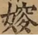

# 血流至足

> 原始 DOCX：[血流至足.docx](<../01-%E5%8E%9F%E5%A7%8BDOCX/20261007/%E5%8D%A2%E9%A3%9E%E5%AE%87/%E8%A1%80%E6%B5%81%E8%87%B3%E8%B6%B3.docx>)
> 本文由脚本按 DOCX OOXML 段落顺序转写，未做校勘、繁简转换或标点统一；内嵌字形以原图保留，原始版式以 DOCX 为准。

<!-- DOCX-BODY-START -->

《戰國策·秦》原文：

説秦王，書十上，而説不行。黑貂之裘敝，黃金百斤盡，資用乏絶，去秦而歸，贏縢履蹻，負書擔囊，形容枯槁，面目黧黑，狀有愧色。歸至家，妻不下紝，不爲炊，父母不與言。蘇秦喟然嘆曰：妻不以我爲夫，不以我爲叔，父母不以我爲子，是皆秦之罪也。乃夜發書，陳篋數十，得太公陰符之謀，伏而誦之，簡練以爲揣摩。

讀書欲睡，引錐自刺其股，血流至足，曰：安有説人主不能出其金玉錦繡，取卿相之尊者乎？期年，揣摩成，曰：此真可以説當世之君矣。於是乃摩燕烏集闕，見説趙王於華屋之下，抵掌而談。趙王大説，封爲武安君，受相印，革車百乘，錦繡千純，白璧百雙，黃金萬鎰，以隨其後，約從散橫，以抑强秦。故蘇秦相於趙，而關不通。

《史記·蘇秦傳》集解：“戰國策曰：‘乃發書，陳篋數十，得太公陰符之謀，伏而誦之，簡練以爲揣摩。讀書欲睡，引錐自刺其股，血流至踵。’”

《太平御覽·人事部》：“戰國策曰：‘蘇秦讀書欲睡，引錐自刺其股，血流至踵。’”

《太平御覽·器物部》：“戰國策曰：‘蘇秦行而歸，負書檐囊，父母不與之。秦歎曰：“皆秦之罪也！”乃夜發書，陳篋數十，得太公陰符，伏而讀之。欲睡，引錐自刺其股，血流至踵。’”

引錐自刺其股，血流至足。《史記·蘇秦傳》集解及《太平御覽·人事部》《器物部》引此并作“血流至踵”。

【念孫案】作“踵”者是也。今本作“足”，傳寫脱其右畔耳。《曲禮》曰：“行不舉足，車輪曳踵。”是“足”爲總名而“踵”爲專稱。踵著於地，故血流至踵而止，若泛言至足，則其義不明。《莊子》亦言汗流至踵，不言至足也。

考據對象

《戰國策·秦》引錐自刺其股，血流至足。

反駁對象

今本“血流至足。”

論點

作“踵”者是也。今本作“足”，傳寫脱其右畔耳。

字詞關係

脫訛

引用書證

《禮記·曲禮》：“凡執主器，執輕而不克。執主器，操幣圭璧，則尚左手，行不舉足，車輪曳踵。”

《莊子·田子方》：“於是無人遂登高山，履危石，臨百仞之淵，背逡巡，足二分垂在外，揖御寇而進之。御寇伏地，汗流至踵。伯昏無人曰：“夫至人者，上闚青天，下潜黃泉，揮斥八極，神氣不變。”

運用術語

作…… 者是也

傳寫脱其右畔

總名、專稱

考據過程

發疑：今本作“血流至足”，而《史記》集解、《太平御览》引此句作“血流至踵”。

預設：作“踵”者是也。今本作“足”，傳寫脱其右畔耳。

取證：《史记·苏秦列传》集解、《太平御览》人事部、器物部引均作“踵”；《礼记·曲礼》“車輪曳踵”、《庄子·田子方》“汗流至踵”證明“足” 是脚部的统称，“踵” 是脚后跟的专称。

釋理： 

文意上，《礼记·曲礼》“車輪曳踵”證明“足”“踵”有別，“踵” 是脚后跟的专称。人端坐时血流至脚跟而止，细节精准。若泛言“至足”，所指范围模糊。

文例上，先秦兩漢文献描写血流、汗流時惯用“至踵”而非“至足”，如《庄子》“汗流至踵”。

字形上，“踵”在传抄中右半“重”脱落，仅剩左半“足”。

結論：作“踵”者是也。

<!-- DOCX-BODY-END -->
